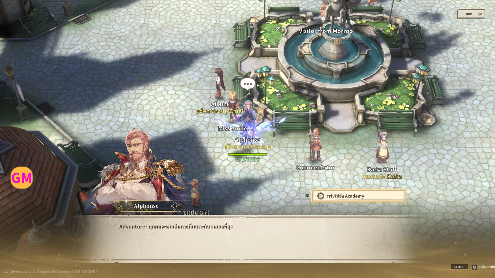
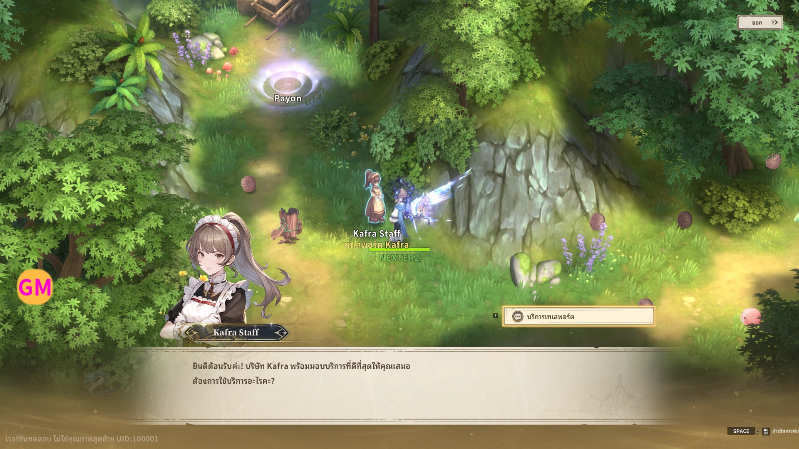
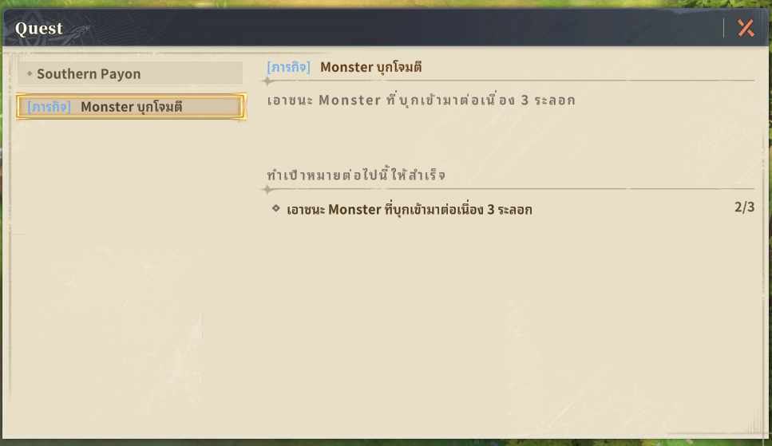
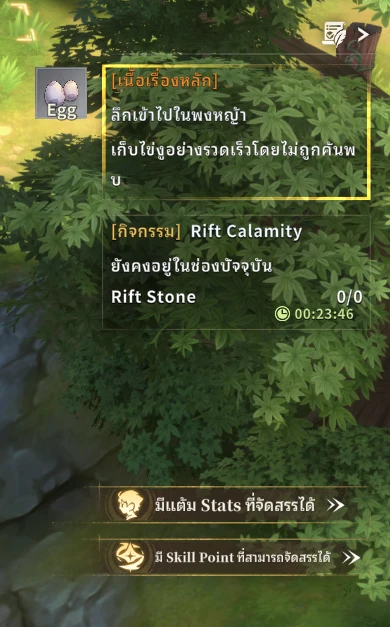
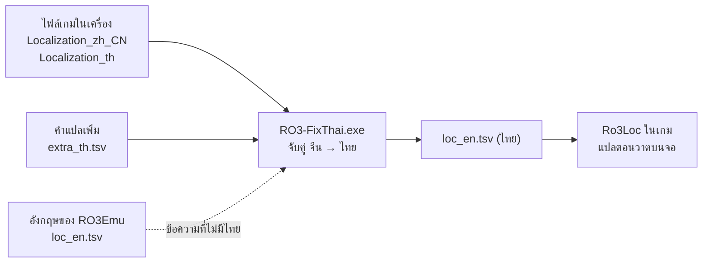

<div align="center">

# 🇹🇭 RO3-FixThai

### ภาษาไทยเต็มรูปแบบสำหรับ RO3Emu

UI · เควส · บทพูด NPC · ชื่อและป้ายใต้ชื่อ NPC · ข้อความจาก server

[](https://github.com/nexterz-th/RO3-FixThai/releases/latest)
[](LICENSE)
[](https://github.com/nexterz-th/RO3-FixThai/releases/latest)

<br>



<sub>ป้ายเหลืองใต้ชื่อ NPC อย่าง <b>ผู้ฝึกสอนอาชีพสูงสุด</b> และ <b>เทเลพอร์ต Kafra</b> เดิมเป็นภาษาจีนเสมอ</sub>

</div>

<br>

> [!TIP]
> **มี RO3Emu อยู่แล้ว?** ดาวน์โหลด zip → แตกไฟล์ไว้ข้าง `RO3Emu.exe` → ดับเบิลคลิก `RO3-FixThai.exe` จบ ไม่ต้องติดตั้งอะไรเพิ่ม

## 📑 สารบัญ

- [✨ ภาพตัวอย่าง](#-ภาพตัวอย่าง)
- [🚀 เริ่มใช้งานใน 1 นาที](#-เริ่มใช้งานใน-1-นาที)
- [❓ คำถามที่พบบ่อย](#-คำถามที่พบบ่อย)
- [🔧 ทำงานยังไง](#-ทำงานยังไง)
- [✍️ ช่วยแปลเพิ่ม](#️-ช่วยแปลเพิ่ม)
- [🛠️ สำหรับนักพัฒนา](#️-สำหรับนักพัฒนา)
- [📜 License](#-license)

---

## ✨ ภาพตัวอย่าง

<table>
  <tr>
    <td width="50%" align="center">
      <br>
      <b>💬 บทพูดและตัวเลือก NPC</b><br>
      <sub>ยินดีต้อนรับค่ะ! · บริการเทเลพอร์ต</sub>
    </td>
    <td width="50%" align="center">
      <br>
      <b>📜 หน้าต่างเควส</b><br>
      <sub>ชื่อเควส · คำอธิบาย · เป้าหมาย</sub>
    </td>
  </tr>
  <tr>
    <td align="center">
      <br>
      <b>🎯 กล่องติดตามเควส</b><br>
      <sub>[เนื้อเรื่องหลัก] · [กิจกรรม] · ปุ่มแจ้งเตือน</sub>
    </td>
    <td align="center" valign="middle">

| ส่วนของเกม | ก่อน | หลัง |
|:--|:--:|:--:|
| UI และเมนู | 🇬🇧 | 🇹🇭 |
| เควสและเป้าหมาย | 🇨🇳 / 🇬🇧 | 🇹🇭 |
| บทพูด NPC | 🇬🇧 | 🇹🇭 |
| ป้ายใต้ชื่อ NPC | 🇨🇳 | 🇹🇭 |
| ชื่อจาก server | 🇬🇧 | 🇹🇭 |

<sub>ประมาณ 27,100 ข้อความเป็นไทย<br>อีกราว 2,400 ที่เกมไม่มีคำแปลไทยใช้อังกฤษแทน</sub>

</td>
  </tr>
</table>

---

## 🚀 เริ่มใช้งานใน 1 นาที

> [!IMPORTANT]
> ต้องใช้ไคลเอนต์ที่ **เลือกภาษาไทยได้** ในตัวเกม (มีไฟล์ `Localization_th.lua.bytes` ใน `ro3_Data\StreamingAssets\Recovery\LuaPayload`)

**1. ดาวน์โหลด** [`RO3-FixThai-win-x64.zip`](https://github.com/nexterz-th/RO3-FixThai/releases/latest)

**2. ปิดเกม** แล้วแตกไฟล์ทั้งหมดไปวางใน **โฟลเดอร์เดียวกับ `RO3Emu.exe`**

```
📁 RO3Emu\
 ├─ RO3Emu.exe          ← ถูกทับด้วยตัวใน zip (สำรองตัวเดิมไว้ก่อนก็ดี)
 ├─ RO3-FixThai.exe     ← ใหม่
 ├─ RO3Emu.settings.json
 └─ data\
```

**3. ดับเบิลคลิก `RO3-FixThai.exe`** โปรแกรมจะหาเกมให้เอง แล้วสร้างภาษาไทยจากไฟล์เกมในเครื่องคุณ (10–20 วินาที)

```
RO3-FixThai - ภาษาไทยสำหรับ RO3Emu
> กำลังสร้างภาษาไทยจากไฟล์เกมในเครื่อง ...
v เสร็จ: 29,539 ข้อความ (ไทย 27,099, แปลเพิ่ม 35, ยังเป็นอังกฤษ 2,411)
```

**4. เข้าเกม** ด้วย `RO3Emu.exe join <server>` ตามปกติ แล้วในเกมเลือก **ภาษาไทย** 🎉

### 📦 ใน zip มีอะไร

| ไฟล์ | หน้าที่ |
|:--|:--|
| `RO3-FixThai.exe` | สร้างภาษาไทยแล้ววางไฟล์ให้ครบ · `RO3-FixThai.exe restore` = กลับเป็นอังกฤษ |
| `RO3Emu.exe` | RO3Emu 1.0.4 + [patch](patches/) แก้ **ป้ายใต้ชื่อ NPC** และ **login ไคลเอนต์ Recovery** |
| `README-TH.txt` | วิธีใช้แบบย่อ |

---

## ❓ คำถามที่พบบ่อย

<details>
<summary><b>ใช้แค่ <code>RO3-FixThai.exe</code> โดยไม่เปลี่ยน <code>RO3Emu.exe</code> ได้ไหม?</b></summary>
<br>

ได้ UI, เควส และบทพูดจะเป็นไทย แต่ **ป้ายเหลืองใต้ชื่อ NPC จะยังเป็นจีน** เพราะ RO3Emu ตัวเดิมไม่ได้ดักข้อความส่วนนั้น
แนะนำให้ทำแบบนี้ถ้าคุณใช้ RO3Emu เวอร์ชันอื่นที่ไม่ใช่ 1.0.4

</details>

<details>
<summary><b>เกมอัปเดตแล้วกลับเป็นภาษาอังกฤษ</b></summary>
<br>

RO3Emu สร้างไฟล์ภาษาอังกฤษใหม่ทับเมื่อตารางภาษาของเกมเปลี่ยน ดับเบิลคลิก `RO3-FixThai.exe` อีกรอบก็กลับมาเป็นไทย

</details>

<details>
<summary><b>อยากกลับไปใช้ภาษาอังกฤษ</b></summary>
<br>

เปิด cmd ในโฟลเดอร์ RO3Emu แล้วพิมพ์

```
RO3-FixThai.exe restore
```

</details>

<details>
<summary><b>ดับเบิลคลิก <code>ro3.exe</code> แล้วเกมปิดเอง</b></summary>
<br>

ไคลเอนต์ Recovery ต้องเปิดผ่าน launcher เท่านั้น ให้เข้าเกมผ่าน `RO3Emu.exe join <server>`

</details>

<details>
<summary><b>ทำไมไม่แจกไฟล์คำแปลไปเลย?</b></summary>
<br>

คำแปลไทยเป็นข้อมูลลิขสิทธิ์ของเกม เราจึงแจกแค่ **เครื่องมือ** ที่สร้างไฟล์ภาษาไทยจากเกมในเครื่องของคุณเอง
แบบเดียวกับที่ RO3Emu สร้างภาษาอังกฤษ ใน repo และใน zip ไม่มีไฟล์ข้อมูลหรือคำแปลของเกมเลย

</details>

<details>
<summary><b>ยังเห็นข้อความจีนบางจุด</b></summary>
<br>

ดูไฟล์ `<โฟลเดอร์เกม>\ro3emu\loc_misses.tsv` ถ้าข้อความอยู่ในไฟล์นั้น แปลว่ายังไม่มีคำแปล [ช่วยแปลเพิ่ม](#️-ช่วยแปลเพิ่ม) ได้เลย
ถ้าไม่อยู่ แปลว่าข้อความถูกวาดผ่านทางที่ยังไม่ได้ดัก [เปิด issue](https://github.com/nexterz-th/RO3-FixThai/issues) พร้อมรูปมาได้

</details>

---

## 🔧 ทำงานยังไง

RO3Emu มีเลเยอร์แปลภาษา (`Ro3Loc`) ที่ดักข้อความทุกตัวก่อนวาดบนจอ แล้วแทนข้อความจีนด้วยคำแปลจากไฟล์ `loc_en.tsv`
ปกติไฟล์นี้เป็นภาษาอังกฤษ **RO3-FixThai สร้างไฟล์เดียวกันนี้ให้เป็นภาษาไทย** และแก้จุดที่ข้อความหลุดการดัก



<details>
<summary><b>📖 ขั้นตอนสร้างไฟล์ภาษาไทย</b></summary>
<br>

1. ถอดรหัสตาราง `Localization_zh_CN` และ `Localization_th` ของเกมด้วย decoder ของ RO3Emu
2. จับคู่ จีน → ไทย จาก id เดียวกัน (ข้อความจีนเดียวมีหลายคำแปล ใช้ตัวที่เจอบ่อยสุด)
3. เป้าหมายเควสในตารางมี `*` ต่อท้าย แต่เกมแสดงโดยไม่มี `*` จึงเก็บทั้งสองแบบ
4. ใส่คำแปลที่เราแปลเอง ([`translations/extra_th.tsv`](translations/extra_th.tsv)) สำหรับข้อความที่ไม่มีในตารางไหนเลย
5. ข้อความที่ตารางไทยไม่มี ใช้อังกฤษจาก `loc_en.tsv` เดิม (ไม่ปล่อยเป็นจีน)
6. บรรทัดแรกใช้ header เดียวกับที่ RO3Emu สร้าง ทำให้ `RO3Emu.exe join` copy ไฟล์ไปข้างเกมให้เองทุกครั้ง

ไฟล์ถูกวาง 2 ที่:

| ที่อยู่ | ใช้ทำอะไร |
|:--|:--|
| `<RO3Emu>\data\loc_en.tsv` | `RO3Emu.exe join` copy ไปให้เกม (ตัวอังกฤษเดิมสำรองเป็น `loc_en.tsv.english`) |
| `<โฟลเดอร์เกม>\ro3emu\loc_en.tsv` | ไฟล์ที่เกมอ่านจริง |

</details>

<details>
<summary><b>🩹 patch ใน <code>RO3Emu.exe</code> แก้อะไรบ้าง</b></summary>
<br>

| ปัญหา | สาเหตุ | แก้ที่ |
|:--|:--|:--|
| ป้ายเหลืองใต้ชื่อ NPC เป็นจีน (`卡普拉传送`, `乐园团教官`, ป้าย Rift Stone) | Lua วาดป้ายผ่าน **MeshUI** (`HUDUber.Text.SetText`) ซึ่งไม่ใช่ TMP, HUD.dll หรือ uGUI | `TextSink.PatchMeshUi` |
| ข้อความบางจุดใน HUD / uGUI ไม่ถูกแปล | `MTextData.Context` และ `UnityEngine.UI.Text.text` ไม่ได้ดัก | `TextSink.PatchHud`, `PatchUiText` |
| ไคลเอนต์ Recovery กด login แล้วไม่มีอะไรเกิดขึ้น | เรียก method **private** ของ class ซ้อน, Mono โยน `MethodAccessException` | `ClientPatcher.OpenPrivateAccess` |
| ชื่อ NPC / ไอเท็มที่ server ส่งมาเป็นอังกฤษ | server ใช้ `Localization_en` เสมอ | `ServerOptions.TextLanguage` |
| วาร์ป Kafra ไป Southern Payon แล้วตัวละครค้าง | จุดวาร์ปอยู่บนช่องที่เดินไม่ได้ | `WorldMap.Standable` |

</details>

<details>
<summary><b>🖥️ ให้ server ส่งข้อความเป็นไทย (สำหรับเจ้าของ server)</b></summary>
<br>

ชื่อ NPC บางตัว ชื่อไอเท็ม และข้อความ error มาจาก server ต้องใช้ server ที่ใส่ [patch](patches/) แล้ว

1. ถอดตาราง `Localization_th.json` จากเกมไปไว้ใน `<data>/config/` ของ server (แบบเดียวกับ `Localization_en.json`)
2. ตั้งค่า `Ro3Emu:TextLanguage=th` เช่น ใน systemd

   ```ini
   Environment=Ro3Emu__TextLanguage=th
   ```

ข้อความที่ตารางไทยไม่มีจะใช้อังกฤษ

</details>

---

## ✍️ ช่วยแปลเพิ่ม

เจอข้อความจีนในเกม? ช่วยกันแปลได้เลย 🙌

1. เปิด `<โฟลเดอร์เกม>\ro3emu\loc_misses.tsv` เกมบันทึกข้อความที่ยังแปลไม่ได้ไว้ที่นี่
2. เพิ่มบรรทัดใน [`translations/extra_th.tsv`](translations/extra_th.tsv) รูปแบบ `จีน<TAB>ไทย`

   ```tsv
   卡普拉传送	เทเลพอร์ต Kafra
   插蓝色品质及以上卡片@{1}张(@{2}/@{3})	ใส่การ์ดคุณภาพสีน้ำเงินขึ้นไป @{1} ใบ (@{2}/@{3})
   ```

   - ข้อความที่มี `<color=...>` ถูกแปลทีละท่อนระหว่าง tag แปลแค่ท่อนข้อความ ไม่ต้องใส่ tag
   - ตัวเลขที่เปลี่ยนได้ใช้ `@{1}`, `@{2}`
3. ส่ง **Pull Request** คำแปลจะเข้าไปอยู่ใน `RO3-FixThai.exe` รุ่นถัดไป

---

## 🛠️ สำหรับนักพัฒนา

<details>
<summary><b>build <code>RO3Emu.exe</code> ที่ patch แล้ว</b></summary>
<br>

```bash
git clone https://github.com/aethai/ro3emu-server
git clone https://github.com/nexterz-th/RO3-FixThai
cd ro3emu-server
git checkout 6befb4b
git am ../RO3-FixThai/patches/*.patch
pwsh tools/release/pack.ps1
```

</details>

<details>
<summary><b>build <code>RO3-FixThai.exe</code></b></summary>
<br>

ต้องใช้ [.NET 10 SDK](https://dotnet.microsoft.com/download) และ ro3emu-server ที่ clone ไว้

```bash
dotnet publish tools/FixThai -c Release -r win-x64 --self-contained -p:PublishSingleFile=true -p:IncludeNativeLibrariesForSelfExtract=true -p:Ro3EmuSrc=<ro3emu-server>
```

</details>

<details>
<summary><b>สร้างไฟล์ภาษาไทยจาก command line (<code>ThaiLoc</code>)</b></summary>
<br>

```bash
dotnet run -c Release --project tools/ThaiLoc -p:Ro3EmuSrc=<ro3emu-server> -- <โฟลเดอร์เกม> out/loc_th.tsv --english <RO3Emu>/data/loc_en.tsv --extra translations/extra_th.tsv
```

หรือแก้ 3 บรรทัดบนสุดของ [`install-thai.cmd`](install-thai.cmd) แล้วดับเบิลคลิก

</details>

<details>
<summary><b>โครงสร้าง repo</b></summary>
<br>

```
📁 RO3-FixThai
 ├─ tools/FixThai/          RO3-FixThai.exe (สำหรับผู้เล่น)
 ├─ tools/ThaiLoc/          ThaiMap.cs (ตัวสร้างภาษาไทย) + command line
 ├─ translations/           คำแปลที่เราแปลเอง
 ├─ patches/                patch ของ ro3emu-server (git am)
 ├─ install-thai.cmd        สคริปต์สำหรับคนที่ build เอง
 └─ docs/images/            ภาพตัวอย่าง
```

</details>

---

## 📜 License

**GPL-3.0** เหมือน [RO3Emu](https://github.com/aethai/ro3emu-server) (patch เป็นงานต่อยอดจาก ro3emu-server)

ไม่มีส่วนเกี่ยวข้องกับ Gravity · ไม่มีไฟล์ข้อมูลหรือคำแปลของเกมอยู่ใน repo และใน release

<div align="center">
<br>
<sub>ทำด้วย ❤️ เพื่อผู้เล่น Ragnarok 3 ชาวไทย</sub>
</div>
